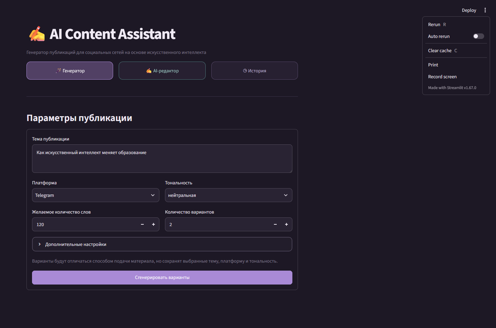
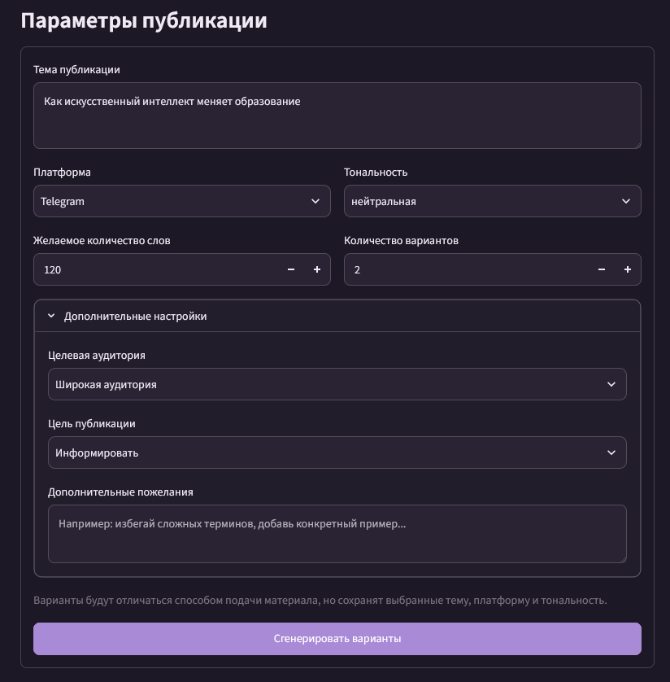
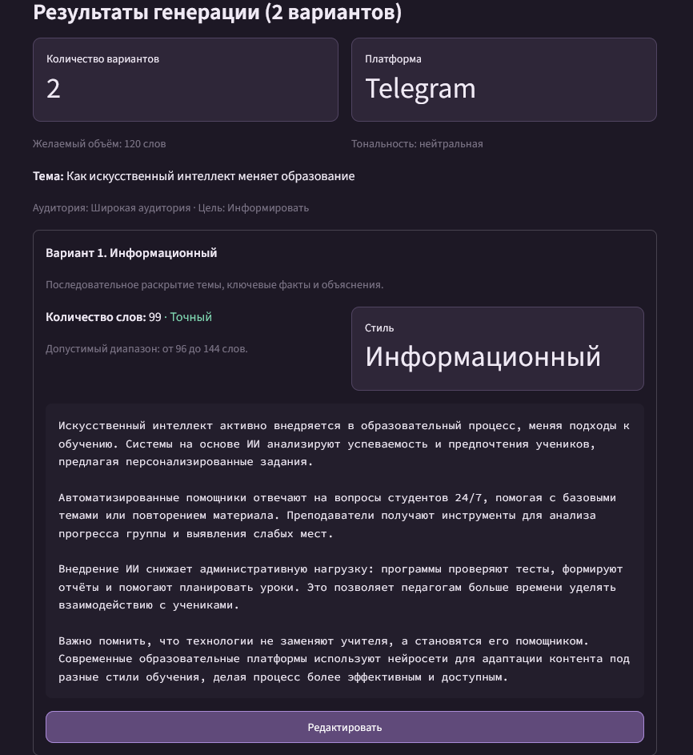
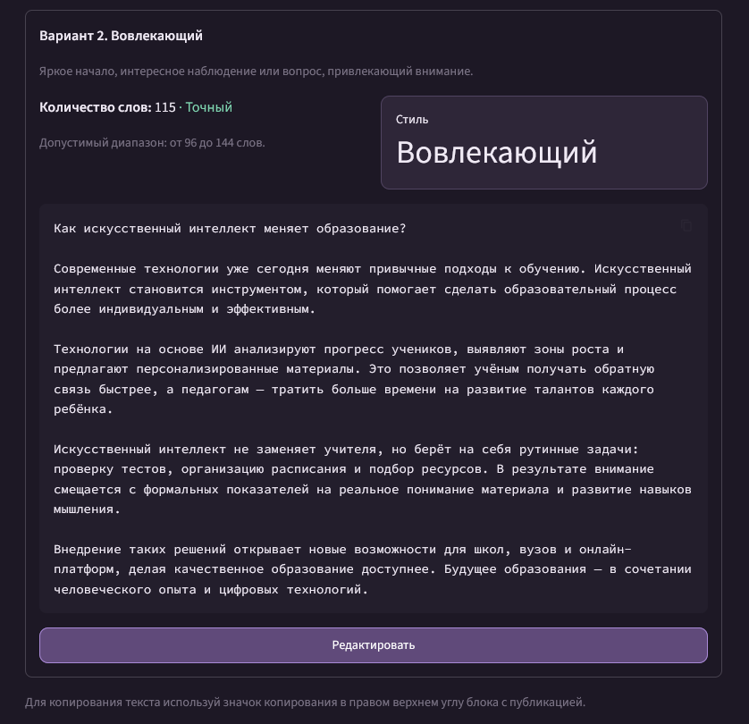
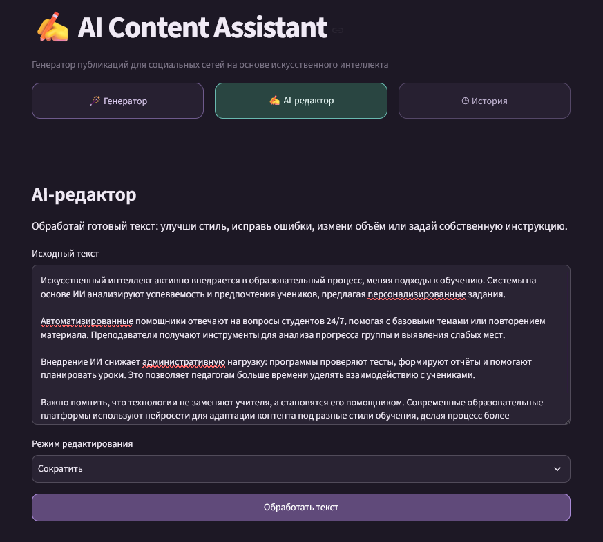
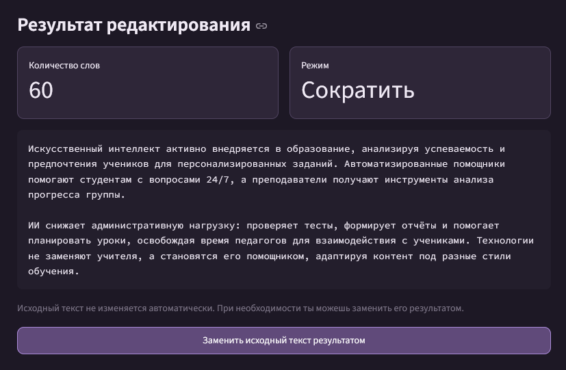
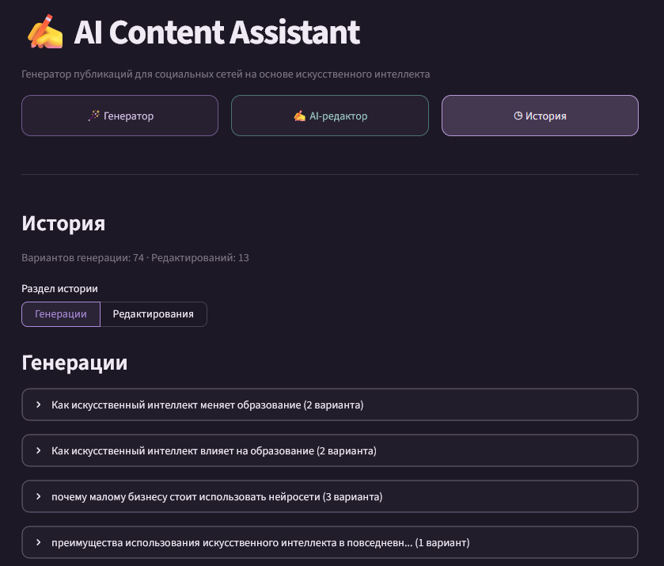

# AI Content Assistant

Приложение для генерации и редактирования публикаций с помощью искусственного интеллекта. Позволяет создавать несколько вариантов текста для социальных сетей, настраивать параметры публикации, обрабатывать готовые тексты и сохранять результаты в истории.

В качестве языковой модели используется **GigaChat**. Основной интерфейс приложения реализован на **Streamlit**, а данные хранятся в локальной базе **SQLite**.

## Возможности

### Генерация публикаций

- Генерация текстов для Telegram и VK.
- Выбор тональности: нейтральная, дружелюбная или профессиональная.
- Настройка желаемого объёма публикации — от 10 до 1000 слов.
- Создание от 1 до 4 вариантов одной публикации.
- Выбор целевой аудитории и цели публикации.
- Возможность добавить дополнительные пожелания.
- Различные стили подачи материала.
- Подсчёт слов и автоматическая корректировка объёма с помощью языковой модели.

### AI-редактор

Готовые тексты можно обработать в отдельном редакторе:

- улучшить текст;
- исправить ошибки;
- сократить или расширить;
- изменить тональность;
- применить собственную инструкцию.

Результат можно просмотреть, оценить его объём и заменить им исходный текст.

### История

Приложение сохраняет результаты генерации и редактирования в локальной базе данных.

В истории доступны:
- просмотр сохранённых публикаций и результатов редактирования;
- разделение записей на генерации и редактирования;
- просмотр параметров генерации;
- повторное использование параметров;
- продолжение редактирования;
- удаление отдельных записей с подтверждением.

## Скриншоты

### Генератор публикаций

Основной интерфейс и дополнительные настройки генерации.





### Результаты генерации

Просмотр сгенерированных вариантов, их стилей и количества слов.





### AI-редактор

Выбор режима обработки и настройка редактирования текста.





### История

Сохранённые генерации и результаты редактирования.



## Технологии

- **Python** — основной язык программирования.
- **Streamlit** — пользовательский веб-интерфейс.
- **GigaChat API** — генерация и редактирование текстов.
- **SQLite** — хранение истории.
- **python-dotenv** — загрузка конфигурации из переменных окружения.
- **unittest** — автоматизированное тестирование.

## Требования

- Python 3.10 или новее.
- Доступ к API GigaChat и необходимые учётные данные.
- Подключение к интернету для обращения к языковой модели.

## Установка и запуск

### 1. Клонирование репозитория

```bash
git clone https://github.com/soulrival/AI-Content-Assistant.git
cd AI-Content-Assistant
```

### 2. Создание виртуального окружения

**Windows (PowerShell):**

```powershell
python -m venv .venv
.venv\Scripts\Activate.ps1
```

**Linux / macOS:**

```bash
python3 -m venv .venv
source .venv/bin/activate
```

### 3. Установка зависимостей

```bash
pip install -r requirements.txt
```

### 4. Настройка GigaChat

Создайте в корневой папке проекта файл `.env` на основе `.env.example`.

Добавьте в него учётные данные GigaChat:

```env
GIGACHAT_CREDENTIALS=your_gigachat_credentials
```

Замените `your_gigachat_credentials` на собственные учётные данные API.

**Важно:** не публикуйте файл `.env` и не добавляйте секретные данные в репозиторий.

### 5. Запуск веб-приложения

```bash
streamlit run web.py
```

После запуска Streamlit приложение будет доступно в браузере.

## Консольный режим

В проекте также предусмотрен консольный режим генерации одной публикации.

Для запуска выполните:

```bash
python main.py
```

Программа последовательно запросит:
- тему публикации;
- платформу;
- тональность;
- желаемое количество слов.

После этого будет выполнена генерация текста с помощью GigaChat.

## Тестирование

Для запуска полного набора автоматизированных тестов:

```bash
python -m unittest discover -s tests -v
```

Дополнительная проверка синтаксиса Python:

```bash
python -m compileall -q .
```

Проверка установленных зависимостей:

```bash
pip check
```

## Структура проекта

```text
AI-Content-Assistant/
│
├── app/
│   ├── config.py       # Конфигурация приложения
│   ├── database.py     # Работа с SQLite
│   ├── editor.py       # AI-редактор
│   ├── generator.py    # Генерация публикаций
│   ├── logger.py       # Логирование
│   ├── prompts.py      # Промпты и инструкции для модели
│   └── ui.py           # Пользовательский интерфейс
│
├── certs/
│   └── russian_trusted_root_ca_pem.crt
│
├── data/               # Локальная база данных
├── logs/               # Файлы журналов
├── screenshots/        # Скриншоты приложения
├── tests/              # Автоматизированные тесты
│
├── .streamlit/
│   └── config.toml
│
├── .env.example
├── .gitignore
├── main.py             # Консольный режим
├── web.py              # Точка входа веб-приложения
└── requirements.txt    # Зависимости проекта
```

## Хранение данных и безопасность

- История генераций и редактирований хранится локально в SQLite.
- База данных создаётся автоматически при первом запуске.
- Настройки API загружаются из файла `.env`.
- Секретные данные и локальные файлы базы данных исключены из Git с помощью `.gitignore`.
- Для HTTPS-соединения с GigaChat используется проверка SSL-сертификатов.

## Автор

**soulrival**

GitHub: [github.com/soulrival](https://github.com/soulrival)